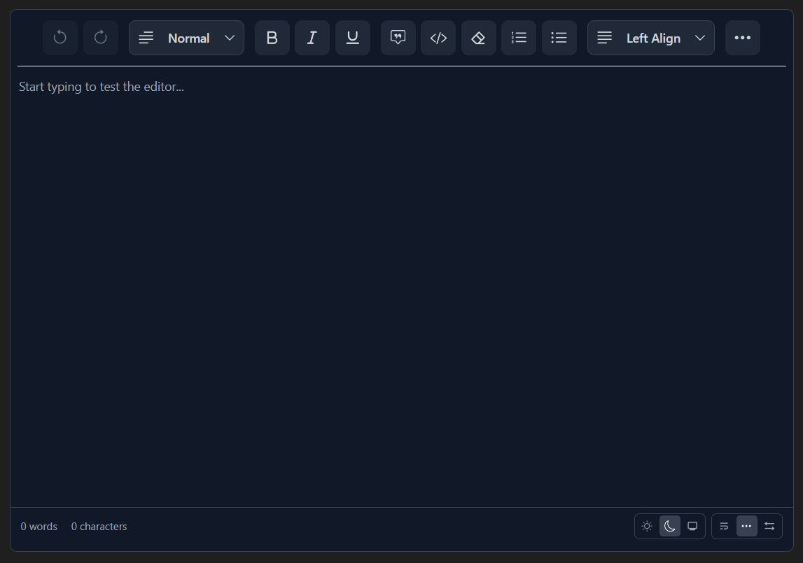

# @innoviatech/lexical-text-editor

A rich text editor component for React, built on [Lexical](https://lexical.dev/). It ships with a complete toolbar covering text, block, table, code, and media tools, plus theming, a responsive layout engine, and TypeScript support, all in a single package with plain CSS (no Tailwind required).

[](https://www.npmjs.com/package/@innoviatech/lexical-text-editor)
[](https://github.com/technohaattech/lexical-text-editor)
[](#license)



## What's New in v3.0

Fourteen new features, all implemented and verified end-to-end in the test app:

| Feature | Name | Description |
|---------|------|-------------|
| Feature 1 | Clear Formatting | Strips all inline formatting from the current selection (bold, italic, underline, colors, case transforms, and more) with one click. Block-level formatting such as headings and lists is preserved. |
| Feature 2 | Code Blocks | Block-level code with syntax highlighting and a language picker: JavaScript, TypeScript, Python, Java, C#, C++, PHP, Ruby, Go, Rust, Swift, Kotlin, HTML, CSS, SQL, JSON, Bash, Markdown, YAML, XML, and more. |
| Feature 3 | Horizontal Rule | Inserts `<hr>` dividers between blocks from the toolbar. |
| Feature 4 | Tables | Insert tables through a dimension grid picker; insert/delete rows and columns, and toggle a header row. Row/column operations detect the current cell automatically. |
| Feature 5 | Indent / Outdent | Toolbar buttons plus `Tab` / `Shift+Tab` nesting inside lists, including multi-level list support. |
| Feature 6 | Font Family Dropdown | Apply Inter, System, Serif, Monospace, Cursive, Georgia, Courier, or revert to Default for the current selection. |
| Feature 7 | Font Size Dropdown | Fixed presets from 12 px to 48 px, applied per selection, with a Default reset. |
| Feature 8 | Find & Replace | Live match count ("n of m"), next/previous navigation, match-case toggle, and Replace / Replace All. Replace All runs as a single undo step. |
| Feature 9 | Source Code View | Toggle between WYSIWYG and raw HTML editing. Edits are applied on demand (Update / Done) so typing malformed markup never floods the undo history. |
| Feature 10 | Fullscreen Mode | Expands the editor to fill the viewport; `Escape` exits. |
| Feature 11 | Word / Character Count | Live counts in a status bar, independently hideable. |
| Feature 12 | Light / Dark / System Theme | `theme` prop plus an end-user switcher in the status bar. Dark styling covers every UI surface; `system` tracks the OS `prefers-color-scheme` live and is SSR-safe. |
| Feature 13 | Toolbar Style Variants | `wrap` (tools flow across lines), `collapse` (single row with a "…" overflow button), and `scrollbar` (single row with a custom slim scrollbar). |
| Feature 14 | Responsive Overflow Toolbar | Predictive width fitting via `ResizeObserver`: primary tools (undo/redo, headings, text formats, alignment, link) stay inline while the rest collapse into the "…" panel on narrow containers. |

### Previous releases

- v2.0.x: Custom image upload handler (`onImageUpload`), image captions, paste-image support, plain-CSS styling (Tailwind removed), and a reduced dependency footprint.

## Features

- **Text formatting:** bold, italic, underline, strikethrough, superscript, subscript, inline code, highlight, text case (uppercase / lowercase / capitalize)
- **Block formatting:** headings (H1 to H6), paragraphs, quotes, ordered & unordered lists, horizontal rules
- **Tables & code:** table editor with row/column operations and header rows; syntax-highlighted code blocks in 20+ languages
- **Links & media:** hyperlink insert/edit/remove; images (URL, upload, paste, captions) and YouTube / Google Drive embeds
- **Editor utilities:** find & replace, source code view, fullscreen, content preview, clear formatting, undo/redo
- **Typography controls:** font family and font size dropdowns, text & background color pickers
- **Theming:** light, dark, and system color schemes with full dark-mode styling
- **Responsive toolbar:** wrap / collapse / scrollbar layouts with automatic overflow handling
- **Status bar:** live word and character count, user-facing theme and layout switchers
- **Developer experience:** fully typed TypeScript API, controlled HTML value model, minimal CSS integration

## Installation

```bash
npm install @innoviatech/lexical-text-editor
```

### Dependencies

The package relies on matching Lexical peer packages. npm 7+ installs peer dependencies automatically; with yarn or pnpm, install them explicitly:

```bash
npm install lexical@^0.36.2 @lexical/react@^0.36.2 @lexical/code@^0.36.2 @lexical/link@^0.36.2 \
  @lexical/list@^0.36.2 @lexical/rich-text@^0.36.2 @lexical/table@^0.36.2 \
  react-color react-icons
```

No Tailwind CSS is required: just import the stylesheet and use the component directly.

## Quick Start

```tsx
import React, { useState } from 'react';
import { LexicalTextEditor } from '@innoviatech/lexical-text-editor';
import '@innoviatech/lexical-text-editor/style.css';

function App() {
  const [content, setContent] = useState('');

  return (
    <LexicalTextEditor
      name="my-editor"
      value={content}
      onChange={setContent}
      placeholder="Start typing your content here..."
    />
  );
}

export default App;
```

## Props

| Prop           | Type                                | Required | Default       | Description                                              |
|----------------|-------------------------------------|----------|---------------|----------------------------------------------------------|
| `name`         | `string`                            | Yes      | none          | Unique identifier for the editor instance                |
| `value`        | `string`                            | Yes      | none          | Current editor content (HTML string)                     |
| `onChange`     | `(value: string) => void`           | Yes      | none          | Callback fired when content changes                      |
| `placeholder`  | `string`                            | No       | `"Some Text"` | Placeholder text when editor is empty                    |
| `maxWidth`     | `string`                            | No       | `"1090px"`    | Adjust the maximum width (`'80%'` or `'800px'`)          |
| `height`       | `string`                            | No       | `"500px"`     | Adjust the height (`'50vh'` or `'500px'`)                |
| `onImageUpload`| `(file: File) => Promise<string>`   | No       | none          | Custom handler for uploading images to your server       |
| `theme`        | `'light' \| 'dark' \| 'system'`     | No       | `'system'`    | Color scheme; `'system'` follows the OS `prefers-color-scheme` |
| `toolbarStyle` | `'wrap' \| 'collapse' \| 'scrollbar'` | No     | `'collapse'`  | Toolbar layout (`'normal'` is a deprecated alias for `'collapse'`) |
| `showWordCount`| `boolean`                           | No       | `true`        | Show live word count in the status bar                   |
| `showCharCount`| `boolean`                           | No       | `true`        | Show live character count in the status bar              |
| `showDisplayControls` | `boolean`                    | No       | `true`        | Show light/dark + toolbar-style switchers in the status bar so end users can change these too |
| `onThemeChange`| `(theme: 'light' \| 'dark' \| 'system') => void` | No | none     | Fires when the end user switches theme from the editor UI (not on prop changes) |
| `onToolbarStyleChange` | `(style: 'wrap' \| 'collapse' \| 'scrollbar') => void` | No | none | Fires when the end user switches toolbar style from the editor UI (not on prop changes) |

## Advanced Usage

### With Initial Content

```tsx
import React, { useState } from 'react';
import { LexicalTextEditor } from '@innoviatech/lexical-text-editor';
import '@innoviatech/lexical-text-editor/style.css';

function App() {
  const [content, setContent] = useState(
    '<p>Welcome to the editor!</p><ul><li>Feature 1</li><li>Feature 2</li></ul>'
  );

  return (
    <LexicalTextEditor
      name="content-editor"
      value={content}
      onChange={setContent}
      placeholder="Write your content..."
      maxWidth="600px"
      height="400px"
    />
  );
}
```

### Theme Control (Light / Dark / System)

Control the color scheme programmatically and persist the end user's choice:

```tsx
const [theme, setTheme] = useState<'light' | 'dark' | 'system'>('system');

<LexicalTextEditor
  name="editor"
  value={content}
  onChange={setContent}
  theme={theme}
  onThemeChange={(t) => {
    setTheme(t);
    localStorage.setItem('editor-theme', t); // persist the user's choice
  }}
/>
```

`'system'` follows the OS color scheme live (including change events) and is SSR/render-safe because `matchMedia` is only touched inside effects.

### Toolbar Style + Display Controls

Choose `wrap` (tools flow to new lines), `collapse` (single row; overflowed tools collapse into a "…" button + modal; this is the default), or `scrollbar` (single scrollable row with a custom slim scrollbar):

```tsx
<LexicalTextEditor
  name="editor"
  value={content}
  onChange={setContent}
  toolbarStyle="collapse"          // 'wrap' | 'collapse' | 'scrollbar'
  onToolbarStyleChange={(style) => persist(style)}
  showDisplayControls              // status-bar switchers for end users (default: true)
/>
```

In `collapse` mode the toolbar measures its width with a `ResizeObserver` and collapses non-primary segments (last in, first out; undo/redo and the heading picker are never collapsed) until everything fits.

### Hiding Status Bar Elements

```tsx
<LexicalTextEditor
  name="editor"
  value={content}
  onChange={setContent}
  showWordCount={false}
  showCharCount={false}
  showDisplayControls={false}
/>
```

### Custom Image Upload

Upload images to your own server instead of using temporary blob URLs:

```tsx
const handleImageUpload = async (file: File): Promise<string> => {
  const formData = new FormData();
  formData.append('image', file);

  const res = await fetch('/api/upload', { method: 'POST', body: formData });
  const data = await res.json();
  if (!data.url) throw new Error('Upload failed');
  return data.url; // permanent URL stored in editor content
};

<LexicalTextEditor
  name="editor"
  value={content}
  onChange={setContent}
  onImageUpload={handleImageUpload}
/>
```

When `onImageUpload` is provided, images selected via the dialog, pasted from the clipboard, or drag-dropped are uploaded to your endpoint. The returned URL is stored permanently in the editor content (unlike temporary blob URLs).

### Image Captions

Images support captions. Fill in the **Caption** field when inserting an image via the dialog, or click **"+ Add caption"** below an inserted image to edit it inline.

### Find & Replace / Source Code View

Both require no configuration; they are toolbar utilities:

- **Find & Replace** (magnifier icon): search with a live "n of m" match count, `Enter` / `Shift+Enter` to navigate, `Match case` toggle, Replace / Replace All, `Escape` closes the panel.
- **Source Code View** (`</>` icon): edit raw HTML in a textarea; **Update** applies edits to the editor, **Done** applies and exits. Toggle the toolbar button again to close without applying.

## Toolbar Reference

| Group | Tools |
|-------|-------|
| Undo / Redo | History operations (redo disabled when empty) |
| Headings | Normal, H1 to H6 |
| Text formats | Bold, Italic, Underline, Quote, Inline Code, Clear Formatting |
| Case & extras | Uppercase, Lowercase, Capitalize, Strikethrough, Highlight, Superscript, Subscript |
| Typography | Font family, font size |
| Colors | Text color, background color (SketchPicker) |
| Lists & blocks | Ordered list, unordered list, indent, outdent, horizontal rule |
| Layout | Alignment (left, center, right, justify) |
| Links & code | Link insert/edit/remove, code block with language picker |
| Media | Image (URL / upload), YouTube & Google Drive video |
| Utilities | Find & Replace, Source Code View, Fullscreen, Content Preview |
| Status bar | Word count, character count, theme switcher, toolbar style switcher |

## Browser Support

- Chrome 90+
- Firefox 88+
- Safari 14+
- Edge 90+

## Troubleshooting

| Problem | Solution |
|---------|----------|
| CSS not loading | Verify the import: `import '@innoviatech/lexical-text-editor/style.css'` |
| Editor not rendering | Confirm React 18+ (Next.js 14+) is installed |
| Runtime Lexical errors | Install the Lexical peer packages at `^0.36.2` (see [Dependencies](#dependencies)); mismatched versions across `node_modules` cause errors. Run `npm dedupe` and configure bundler-level dedupe for `lexical`. |
| TypeScript errors | Update to TypeScript 5.0+ |
| Missing styles | Confirm the CSS import path is correct |
| Dropdowns / popovers clipped | Do not add `overflow: hidden` to ancestors of the toolbar; popovers are absolutely positioned and require `overflow: visible` on ancestor elements. |

## Version Compatibility

- React 18+
- Next.js 14+
- Lexical 0.36.2
- TypeScript 5.0+

## License

[MIT](https://github.com/technohaattech/lexical-text-editor/blob/main/LICENSE) © Innoviatech

## Publishing to npm (Maintainers)

Release process for this package:

### Prerequisites

1. An npm account with publish access to the `@innoviatech` scope
   (`npm access ls-packages innoviatech` to verify).
2. `npm login` completed locally. If 2FA is enabled, keep the authenticator ready.
3. A clean working tree on `main`:

```bash
git status
git checkout main
git pull origin main
```

### Step 1: Bump the version

```bash
npm version 3.0.0 --no-git-tag-version
# or semantic shortcuts:
#   npm version patch   # 3.0.1  bugfix / docs / styles
#   npm version minor   # 3.1.0  new feature, backwards-compatible
#   npm version major   # 4.0.0  breaking change
```

Commit and tag:

```bash
git add package.json package-lock.json
git commit -m "chore: release v3.0.0"
git tag v3.0.0
```

### Step 2: Build and sanity-check

`prepublishOnly` runs the build automatically on publish; verify beforehand:

```bash
npm run build          # dist/index.js, dist/index.esm.js, dist/index.d.ts, dist/lexical-editor.css
npx tsc --noEmit       # typecheck the source
npm pack --dry-run     # review the exact tarball contents (files + sizes)
```

Checklist for the dry-run output:
- [ ] `dist/index.js`, `dist/index.esm.js`, `dist/index.d.ts`, `dist/lexical-editor.css` present
- [ ] `README.md`, `package.json` present
- [ ] No stray files (`src/`, `rollup.config.js`, test folders); the `files` whitelist in `package.json` enforces this

### Step 3: Smoke-test the tarball locally (recommended)

```bash
npm pack                       # innoviatech-lexical-text-editor-3.0.0.tgz
cd ../test-app
npm install ../Lexical-Text-Editor/innoviatech-lexical-text-editor-3.0.0.tgz
npm run build && npm run dev   # exercise the editor once
```

### Step 4: Publish

The package is scoped, so public access must be requested explicitly:

```bash
npm publish --access public          # enter OTP if prompted
```

If the publish was interrupted, the version metadata may already be reserved.
Check `npm view @innoviatech/lexical-text-editor` and recover with
`npm publish --foreground-scripts`, or as a last resort unpublish and republish deliberately.

### Step 5: Verify and tag the release

```bash
npm view @innoviatech/lexical-text-editor version   # should print the new version
git push origin main --tags
```

Create a GitHub Release under `technohaattech/lexical-text-editor → Releases`, select the
`v3.0.0` tag, paste the "What's New" notes, and publish the release.

### Quick reference

```bash
npm run build && npx tsc --noEmit               # 1. build + typecheck
npm version <x.y.z> --no-git-tag-version        # 2. bump
git add -A && git commit -m "chore: release vX.Y.Z" && git tag vX.Y.Z
npm pack --dry-run                              # 3. inspect tarball
npm publish --access public                     # 4. publish
git push origin main --tags                     # 5. push code + tag
```

## Support & Community

### Reporting Issues

Open an issue at [GitHub Issues](https://github.com/technohaattech/lexical-text-editor/issues) and include:

- Environment details (browser, OS, React / Next.js version)
- Steps to reproduce
- Expected vs. actual behavior
- Relevant code snippets and screenshots, if applicable

### Feature Requests

Submit ideas via the
[feature request template](https://github.com/technohaattech/lexical-text-editor/issues/new?template=feature_request.md).

### Contributing

Contributions are welcome:

- Improve the documentation
- Fix bugs or add features via pull requests
- Write tests
- Star and share the repository

Give the project a ⭐ on GitHub if you find it useful; it helps other developers discover it.

---

*Built and maintained by the Innoviatech team.*
